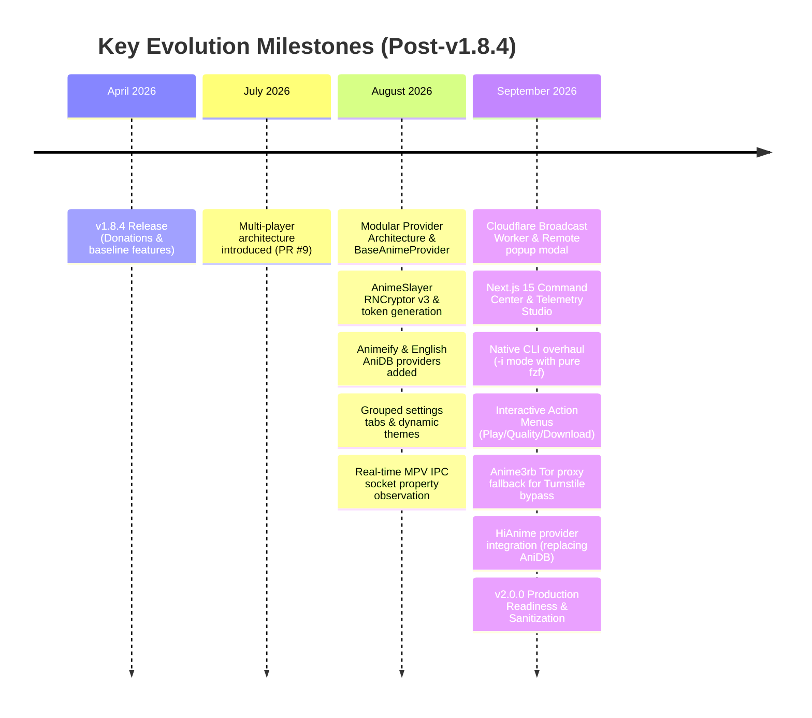

# ani-cli-arabic: Detailed Evolution & Changes Summary (Post-v1.8.4 to v2.0.0)

> **Document Version:** 2.0.0  
> **Repository:** [np4abdou1/ani-cli-arabic](https://github.com/np4abdou1/ani-cli-arabic)  
> **Base Reference:** `v1.8.4` (Commit `51004a8` — April 16, 2026)  
> **Head Reference:** `v2.0.0` (Commit `916ad17` — September 21, 2026)  
> **Scope:** Complete architectural overhaul, multi-provider engine, enhanced media playback, interactive CLI rewrite, modern TUI, and cloud infrastructure.

---

## Table of Contents
1. [Executive Overview](#1-executive-overview)
2. [Major Architecture Revolution: Multi-Provider Ecosystem](#2-major-architecture-revolution-multi-provider-ecosystem)
3. [Media Playback & Real-Time IPC Engine](#3-media-playback--real-time-ipc-engine)
4. [Interactive Minimal CLI Mode (`-i`) Complete Rewrite](#4-interactive-minimal-cli-mode--i-complete-rewrite)
5. [Full-Screen TUI Visual & Interactive Redesign](#5-full-screen-tui-visual--interactive-redesign)
6. [Cloud Operations, Remote Broadcast & Infrastructure](#6-cloud-operations-remote-broadcast--infrastructure)
7. [System Hardening, Debugging & Deployment Readiness](#7-system-hardening-debugging--deployment-readiness)
8. [Comprehensive Version Comparison Matrix](#8-comprehensive-version-comparison-matrix)
9. [Chronological Commit Timeline](#9-chronological-commit-timeline)

---

## 1. Executive Overview

Between **v1.8.4** (April 2026) and the current **v2.0.0** release (September 2026), `ani-cli-arabic` underwent the most comprehensive refactoring in its history. What started as a single-source scraper tightly coupled to a single player has evolved into an enterprise-grade, modular terminal application featuring:

*   **4 Independent Anime Providers** (Arabic & English) with automatic Cloudflare/Turnstile bypassing.
*   **Universal Player Support** with real-time JSON-IPC socket monitoring, timestamp resumption, and percentage progress tracking.
*   **A completely rewritten `-i` CLI Mode** powered by native `fzf`, zero Arabic RTL text clipping, and interactive action menus.
*   **A polished Full-Screen TUI** with multi-palette themes, grouped settings tabs, and smooth animations.
*   **Cloudflare Edge Integration** supporting real-time remote announcements and analytics without compromising user privacy.

---

## 2. Major Architecture Revolution: Multi-Provider Ecosystem

In `v1.8.4`, the application relied exclusively on a brittle, monolithic scraper for Anime3rb. Any website layout update or CDN rotation broke the entire tool. In v2.0, the core was decoupled into an abstract **Provider Architecture**:

```
                  ┌───────────────────────────────┐
                  │    BaseAnimeProvider (ABC)    │
                  └───────────────┬───────────────┘
                                  │
      ┌───────────────────────────┼───────────────────────────┐
      │                           │                           │
┌─────▼───────┐           ┌───────▼───────┐           ┌───────▼───────┐
│  Anime3rb   │           │  AnimeSlayer  │           │    HiAnime    │
│  (Primary)  │           │  (Secondary)  │           │   (English)   │
└─────────────┘           └───────────────┘           └───────────────┘
                                  │
                          ┌───────▼───────┐
                          │   Animeify    │
                          │  (Tertiary)   │
                          └───────────────┘
```

### 2.1. Anime3rb (Primary Arabic Engine)
*   **Livewire 3 Engine & Snapshot Resolution:** Reverse-engineered the `wire:snapshot` and state payload parsing required to extract dynamic episode player URLs.
*   **Turnstile & Datacenter IP Bypass via Tor Fallback:** Oracle Cloud / VPS datacenter IPs are blocked by Cloudflare Turnstile on `video.vid3rb.com`. Added an automated failover that routes requests through a local Tor proxy (`socks5://127.0.0.1:9050`) only when Turnstile is mounted, leaving ordinary clients on direct connection.
*   **Direct CDN Extraction via HTTP 302 Tracking:** Bypassed embedded player iframes by capturing HTTP 302 `Location` redirects directly to `https://files-X.vid3rb.com/.../1080p.mp4?noip=yes`, allowing high-speed MPV streaming with zero proxy overhead.
*   **Auto Intro-Skip:** Added automated 5-second offset skipping to bypass introductory branding.

### 2.2. AnimeSlayer (Secondary Arabic Engine)
*   **Cryptographic Security Engine:** Reverse-engineered the native Android mobile app's communication protocol:
    *   Dynamic token hashing with proprietary salts (`AES-128-ECB`).
    *   Decryption of encrypted RNCryptor v3 response payloads containing streaming mirrors.
*   **Multi-Host Mirror Extractors:** Added extraction support for 10+ mirror CDNs: MediaFire, Google Drive, Goodstream HLS, Streamtape, Vinovo, OK.ru, Mp4Upload, Mixdrop, Uptostream, and Fembed.
*   **Native Discovery Filters:** Integrated official Anime Slayer genre tags, seasonal filters, and studio browsing.

### 2.3. Animeify (Tertiary Arabic Engine)
*   Integrated the **Animeify** API to provide high-speed redundant streaming links when other providers experience downtime.
*   Automated dead-link filtering and direct MediaFire CDN link prioritization.

### 2.4. HiAnime (English Provider — Ported from Upstream `ani-cli` v5.1)
*   **Upstream Migration:** Upstream `ani-cli` migrated from `anidb` to `hianime.at` in version 5.1 due to aggressive Cloudflare 503 challenges.
*   **ZokoAnime XOR Stream Decryption:** Replicated the upstream de-obfuscation pipeline in Python:
    1.  Fetches episode server metadata and base64-encoded ZokoAnime embed hashes.
    2.  Extracts obfuscated player payloads (`window.__P`).
    3.  Performs byte-wise XOR decryption against the key `otaku-embed-v1` to extract direct master `.m3u8` playlists and VTT English subtitle tracks.

---

## 3. Media Playback & Real-Time IPC Engine

In `v1.8.4`, playback was launched as a blind `subprocess.run(["mpv", ...])`, with no feedback on progress or watch state.

### 3.1. Real-Time MPV JSON-IPC Streaming
*   Implemented `MpvTracker` which establishes an asynchronous UNIX domain socket (`/tmp/ani_mpv_*.sock`) or Windows Named Pipe (`\\.\pipe\ani_mpv_*`).
*   Configured MPV with `--idle=yes`, `--input-ipc-server`, and dispatched `observe_property` subscriptions for:
    *   `time-pos` (current playback position in seconds)
    *   `duration` (total media duration)
    *   `percent-pos` (percentage watched)
*   Eliminated periodic polling; state changes are handled reactively via IPC event streaming.

### 3.2. Resume Playback & Exact Timestamp Tracking
*   Episodes remember their exact timestamp upon player exit.
*   Re-opening an episode presents an automatic or prompt-based resume point.
*   Episodes past 85% completion are marked as `[✓ 100% Completed]`.

### 3.3. Multi-Player Ecosystem
Full support and automatic discovery added for:
*   **MPV** (Primary, IPC-enabled)
*   **VLC Media Player** (Fullscreen, `--meta-title`, `--start-time`)
*   **Celluloid** (Modern GTK frontend)
*   **IINA** (Native macOS frontend)
*   **Syncplay** (Multi-user synchronized playback)
*   **MPC-HC / MPC-BE** (Windows)

---

## 4. Interactive Minimal CLI Mode (`-i`) Complete Rewrite

The legacy CLI mode had severe usability issues: terminal splits truncated Arabic episode titles, Arabic text suffered RTL visual corruption, and mouse clicks caused accidental input cancellation.

```
       ⚡
  █▀█ █▄ █ █   █▀▀ █   █   █▀█ █▀▄
  █▀█ █ ▀█ █   █▄▄ █▄▄ █   █▀█ █▀▄
  v2.0.0 • Provider: Anime3rb • gh:np4abdou1/ani-cli-arabic
  E: Latest  M: Movies   T: Trending  P: Popular   R: Top Rated
  F: Favs    H: History  G: Genres    S: Studios   C: Provider
  A: Autoplay (OFF)  Q: Quit

  ╭─  Search
  ╰─>
```

### Key Improvements in `-i`:
1.  **Pure Native `fzf` Integration:** Eliminated arbitrary preview-pane splits. Titles render clearly on the left margin with natural wrapping.
2.  **Interactive Selection Modal:** Selecting an episode now displays an intuitive action menu:
    *   `▶ Play` (Launches active player)
    *   `⚙ Change Quality` (Select 1080p, 720p, 480p, Auto)
    *   `📥 Download` (Single episode via Aria2c, IDM, or built-in engine)
    *   `📦 Batch Download` (Interactive range selector: `1-12`, `all`, etc.)
    *   `♥ Favorite Toggle`
    *   `← Back`
3.  **Mouse Trapping Fix:** Removed accidental `left-click:accept` traps that caused fzf to prematurely submit selections or drop into batch mode; standard `enter` and `double-click` bindings are now enforced.
4.  **Post-Playback Control Loop:** After an episode ends, users are immediately prompted:
    *   `▶ Next Episode` (Plays Episode N+1)
    *   `🔁 Replay`
    *   `◀ Previous Episode`
    *   `📋 Select Episode`
    *   `← Return to Search`
5.  **Autoplay Engine (`A` key):** Toggle automated sequential episode playback on/off with persistent settings storage.

---

## 5. Full-Screen TUI Visual & Interactive Redesign

The full-screen Rich-based terminal UI was overhauled for aesthetic consistency and usability:

*   **Luminous Pulse Branding:** Dynamically styled ASCII header featuring a centered lightning bolt (`⚡`) that responds to the selected theme palette.
*   **Universal Theme Engine:** Support for 5 color themes (`Blue`, `Purple`, `Emerald`, `Rose`, `Amber`) with live in-memory propagation across all active views without app restart.
*   **Grouped Tabbed Settings:** Replaced linear list with a 4-tabbed settings modal:
    1.  *General / Player* (Default player, fullscreen toggle, autoplay)
    2.  *Download* (Default quality, engine: internal / aria2c / idm, download directory)
    3.  *System* (Discord Rich Presence, debug logging)
    4.  *Themes* (Live theme switcher with instantaneous preview)
*   **Interactive Donation Badge:** Standardized `[d] Donate` button with styled border and direct link generation.
*   **History & Progress Redesign:** 4-column aligned history table with formatted dates, episode badges, and color-coded completion status bars (`[✓ 95%]`).
*   **BouncingBar Spinner:** Replaced standard console spinners with a custom non-blocking terminal animation.

---

## 6. Cloud Operations, Remote Broadcast & Infrastructure

To support long-term maintainability, edge cloud integrations were developed to keep users informed without requiring code updates:

1.  **Cloudflare Remote Broadcast Engine:**
    *   A lightweight edge worker reads notifications from Cloudflare KV.
    *   Supports urgent maintenance alerts, release highlights, or domain migration notices.
    *   Includes HTTP `Cache-Control: no-cache` headers and millisecond timestamp queries to prevent CDN edge-caching.
2.  **Next.js 15 Command Center & Analytics (Private Internal Tool):**
    *   Built a dark OLED-themed operations dashboard with Next.js 15 App Router, Tailwind CSS, Framer Motion, and Cloudflare D1/KV bindings.
    *   Includes a real-time **Broadcast Studio** with a simulated macOS-style terminal preview to draft and preview announcements before pushing to CLI clients.
3.  **Dynamic In-App Changelog:**
    *   Displays an in-terminal modal highlighting new features upon version upgrade, with automatic scroll height bounding.

---

## 7. System Hardening, Debugging & Deployment Readiness

*   **Strict Production Sanitization:** Cleaned up user-facing outputs. Removed all internal telemetry indications, dashboard strings, and tracking banners.
*   **Centralized Zero-Overhead Debug Logger (`src/logger.py`):**
    *   Opt-in flag `-d` / `--debug` activates real-time console mirroring and detailed file logging (`~/.ani-cli-arabic/logs/debug.log`).
    *   Logs API round-trips, network status codes, IPC socket events, and downloader outputs.
*   **Background Maintenance Daemon:**
    *   Automatic background garbage collection of stale IPC sockets, lingering PID files, and temporary video fragments.
*   **Timeout & Rate-Limit Hardening:**
    *   Configured strict connection/read timeouts (10s) across all network sessions to prevent CLI lockups on unresponsive CDNs.

---

## 8. Comprehensive Version Comparison Matrix

| Feature / Dimension | v1.8.4 (April 2026) | v2.0.0 (September 2026) |
| :--- | :--- | :--- |
| **Active Providers** | 1 (Anime3rb only) | **4** (Anime3rb, AnimeSlayer, Animeify, HiAnime) |
| **English Content** | None | **Full HiAnime Integration** (ZokoAnime XOR HLS) |
| **Cloudflare Bypass** | Basic User-Agent | **Tor Proxy Fallback + 302 Tracking + curl_cffi** |
| **Media Players** | MPV only (basic call) | **MPV, VLC, Celluloid, IINA, Syncplay, MPC-HC** |
| **Watch Progress** | None | **Exact second resume point + % progress tracking** |
| **MPV Feedback** | Blind subprocess | **Bidirectional JSON IPC Socket Event Streaming** |
| **CLI Mode (`-i`)** | Split-pane (RTL Arabic bugs) | **Organic Left-Aligned `fzf` + Action Modals** |
| **Mouse Support in CLI** | Buggy (click trapped / exited) | **Smooth `double-click` / `enter` navigation** |
| **Batch Download** | Basic text loop | **Interactive range parser (`1-12`, `all`, comma)** |
| **Settings Interface** | Single flat list | **4-Tab Grouped Settings with live color apply** |
| **Logging & Diagnostics** | Unstructured `print()` | **Centralized `DebugLogger` (`-d` / `--debug`)** |
| **Remote Announcements** | None | **Edge Worker Broadcast with terminal modal** |
| **Terminal Autoplay** | Unsupported | **Full Autoplay toggle (`A` hotkey)** |

---

## 9. Chronological Commit Timeline



---

*Generated for deployment verification on ani-cli-arabic v2.0.0.*
